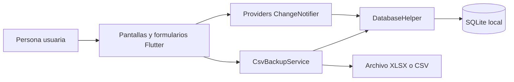
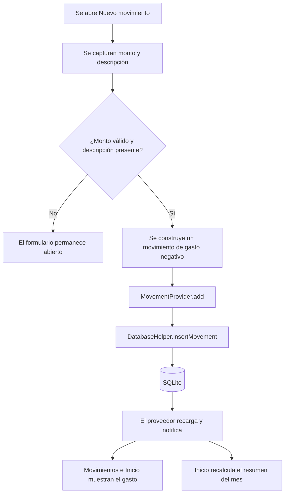
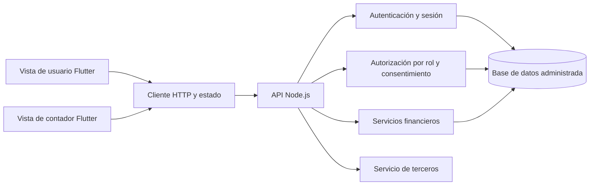

# Arquitectura de KoPay

## 1. Propósito y alcance

Este documento define la arquitectura prevista para KoPay y guía las tarjetas del [backlog](backlog-desarrollo-desde-cero.md). Los componentes se implementarán y verificarán por sprint en el repositorio de entrega.

## 2. Vista general

KoPay se desarrollará en Flutter. La interfaz se organizará en `lib/screens/` y `lib/widgets/`. Los proveedores de `lib/providers/` mantendrán el estado de tarjetas, deudas, ingresos, movimientos, categorías y ajustes. `DatabaseHelper` concentrará el acceso a SQLite local. `CsvBackupService` realizará la exportación XLSX y la importación de archivos CSV compatibles.

### Módulos y ubicación propuesta

| Módulo | Archivos principales | Responsabilidad |
| :--- | :--- | :--- |
| Inicio y navegación | `home_screen.dart`, `splash_screen.dart` | Resumen mensual, actividad reciente, tarjetas y próximos pagos. |
| Movimientos e ingresos | `movements_screen.dart`, `add_movement_sheet.dart`, `add_income_sheet.dart` | Captura y consulta de entradas y salidas de dinero. |
| Tarjetas y deudas | Formularios y detalles en `lib/widgets/` | Registro, consulta y pagos. |
| Estado | `lib/providers/` | Carga de datos y notificación a la interfaz. |
| Persistencia | `lib/database/database_helper.dart` | Tablas SQLite y operaciones de lectura y escritura. |
| Ajustes y archivos | `settings_screen.dart`, `csv_backup_service.dart` | Moneda, idioma, exportación XLSX, importación CSV y borrado local. |
| Formato y vencimientos | `lib/utils/` | Fechas, importes y próximos pagos. |

### Contratos previstos entre pantallas y estado

| Pantalla o formulario | Proveedor | Entrada y respuesta esperada |
| :--- | :--- | :--- |
| Nuevo gasto y Movimientos | `MovementProvider` | Recibe monto, descripción, categoría y fecha; valida el registro, lo guarda y notifica la lista actualizada. |
| Nuevo ingreso | `IncomeProvider` | Recibe nombre, monto y fecha; guarda un ingreso válido y notifica el cambio. |
| Inicio | `MovementProvider` e `IncomeProvider` | Consulta los registros del periodo seleccionado y presenta los totales calculados para ese mes. |
| Tarjetas y deudas | Proveedores de tarjetas y deudas | Reciben altas, cambios y pagos válidos; devuelven saldos y próximos vencimientos actualizados. |
| Ajustes | Proveedor de ajustes | Lee y guarda moneda, idioma y categorías; avisa a las pantallas cuando cambian. |

Las operaciones de escritura pasarán del formulario al proveedor y de este a `DatabaseHelper`. La pantalla recibirá el resultado de validación y el estado actualizado; no accederá directamente a SQLite. Los nombres definitivos de métodos se acordarán al implementar cada módulo.

## 3. Patrón de diseño propuesto

La app usará `Provider` y `ChangeNotifier` para que las pantallas reaccionen a cambios de estado. Cuando un formulario guarde un registro, el proveedor lo escribirá mediante `DatabaseHelper`, recargará la lista y notificará a sus consumidores. Este flujo aplicará el patrón de **observador** al estado de la interfaz. `DatabaseHelper.instance` ofrecerá una instancia compartida, equivalente a un **singleton** para el acceso a la base local. La API Node.js se construirá como servicio separado.

## 4. Flujo del registro de un gasto

El formulario deberá validar un monto numérico mayor que cero y una descripción no vacía antes de guardar. El resumen del mes considerará ingresos, gastos y pagos de tarjeta por separado. La ejecución en un dispositivo deberá confirmar el resultado visible; el diagrama representa el flujo previsto.

## 5. Datos y límites de la versión

SQLite local tendrá las tablas `cards`, `debts`, `movements`, `incomes` y `settings`. Las categorías se guardarán dentro de `settings`. Los ingresos tendrán una tabla propia y se mostrarán junto a movimientos mediante una conversión para la lista. La representación de importes y sus reglas de redondeo se definirán y comprobarán con casos financieros.

La opción **Exportar respaldo** de Ajustes generará un archivo **XLSX**. La opción **Importar CSV** recibirá un archivo **CSV** compatible y reemplazará los datos locales después de pedir confirmación. El XLSX exportado no se importará directamente con ese botón. La guía de evidencias y el plan de pruebas tratan ambas rutas por separado.

## 6. Arquitectura objetivo: vista de usuario y vista de contador

La persona usuaria mantiene sus pantallas financieras y añade gestión de cuenta y autorización de contador. La cuenta de contador inicia sesión, ve sus clientes autorizados y consulta el resumen y movimientos de uno de ellos. La autorización se comprueba **en cada consulta del servidor**; ocultar botones en Flutter no sustituye ese control. El contador tiene acceso de solo lectura. La revocación bloquea nuevas consultas. Los datos se filtran por propietario y periodo; ninguna cuenta recibe registros de otra por cambiar un identificador en la URL.

La sincronización prevista mantendrá SQLite local y enviará los datos a la API Node.js mediante `SyncService`. Cada copia llevará una versión; PostgreSQL rechazará un envío basado en una versión anterior. Ante un conflicto, la app pedirá confirmación antes de restaurar la copia remota. El backend recibirá la conexión PostgreSQL mediante `DATABASE_URL` y Flutter la URL de la API mediante `API_URL`. Las migraciones y el comportamiento con una base administrada, dos dispositivos y el servicio externo deberán comprobarse. Los secretos permanecerán fuera del repositorio.

## 7. Componentes previstos para la entrega

| Componente solicitado para la integradora | Desarrollo previsto | Criterio de cierre |
| :--- | :--- | :--- |
| Autenticación | Registro, inicio, renovación, cierre y recuperación por correo. | Configurar remitente y verificar todos los flujos. |
| Configuración por ambientes | Variables `DATABASE_URL`, `JWT_SECRET` y `API_URL`. | Definir valores por ambiente, proteger secretos y verificar la configuración de entrega. |
| Base de datos administrada | PostgreSQL con migraciones y datos separados por cuenta. | Elegir y configurar el servicio; probar migraciones y aislamiento. |
| Servicio de terceros | Consulta informativa de tipos de cambio desde Node.js. | Comprobar respuesta real, errores, fecha y visualización en un dispositivo. |
| Vista de contador | Pantallas propias, solicitudes de enlace y rutas de consulta autorizada. | Verificar permisos, revocación y datos visibles con cuentas de prueba. |
| APK final | Compilación Android de entrega. | Instalar en un dispositivo y registrar la evidencia. |

Estas decisiones tienen historias, casos de prueba y tareas documentales. Su ejecución y el proveedor elegido se registrarán en el tablero cuando ocurran.
