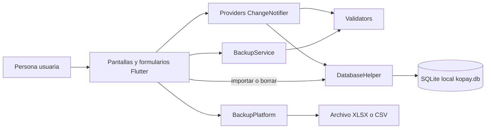
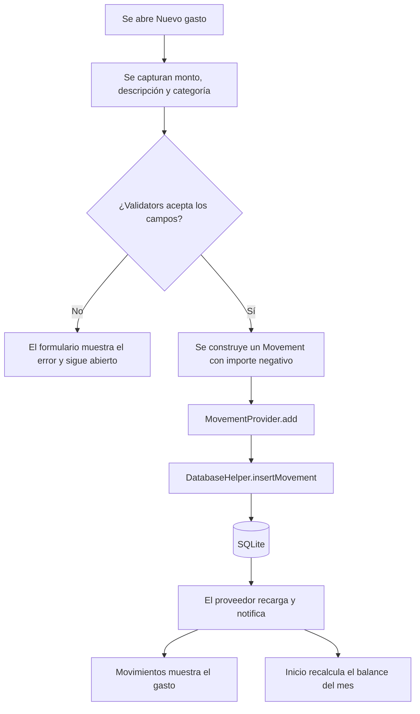
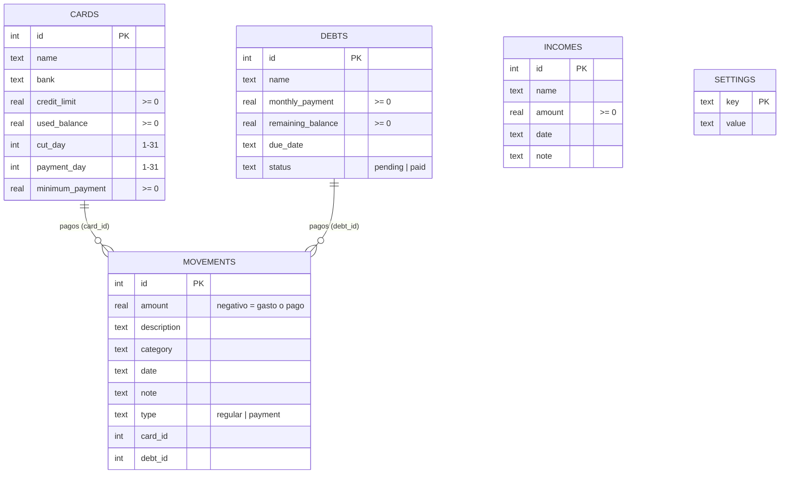
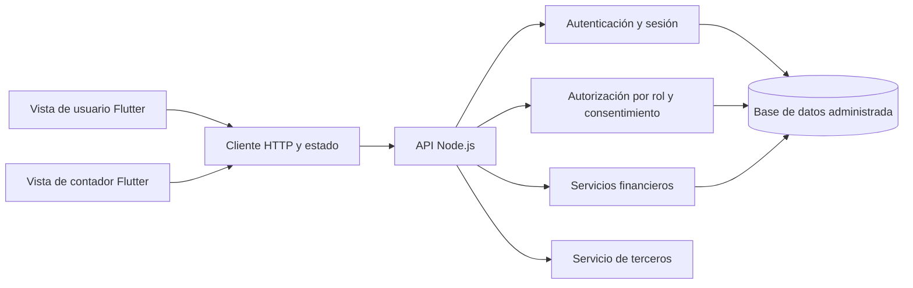

# Arquitectura de KoPay

## 1. Propósito y alcance

Este documento describe la arquitectura de KoPay y guía las tarjetas del [backlog](backlog-desarrollo-desde-cero.md). Las secciones 2 a 5 describen lo implementado en la app local; las secciones 6 y 7, la arquitectura objetivo con API y vista de contador.

## 2. Vista general

> **Estado:** implementado en `develop` al 2026-11-24 (S2-02, [#34](https://github.com/JanettheMillan/KoPay/issues/34)). Lo que aún no existe se marca como *pendiente*, con su tarjeta.

KoPay está hecha en Flutter:
- La interfaz vive en `lib/screens/` y `lib/widgets/`.
- Los proveedores de `lib/providers/` guardan el estado de movimientos, ingresos, tarjetas, categorías y ajustes.
- `DatabaseHelper` es el único que habla con SQLite.
- `BackupService` arma el XLSX de respaldo y valida el CSV de importación. `BackupPlatform` abre el selector de archivos y la hoja de compartir del teléfono.

### Módulos y archivos

| Módulo | Archivos | Responsabilidad |
| :--- | :--- | :--- |
| Inicio | `screens/home_screen.dart` | Balance, ingresos, gastos y movimientos del mes elegido. Lee `MovementProvider` e `IncomeProvider`. |
| Movimientos e ingresos | `screens/movements_screen.dart`, `widgets/add_movement_sheet.dart`, `widgets/add_income_sheet.dart` | Historial que junta gastos e ingresos (`buildHistory`), alta y edición. |
| Categorías | `widgets/category_picker_sheet.dart` | Selector con búsqueda, alta, renombrado y borrado; `categoryEmoji`. |
| Ajustes | `screens/settings_screen.dart` | Moneda, idioma, exportar XLSX, importar CSV y borrar datos. |
| Tarjetas, deudas y pagos | `models/card_model.dart`, `models/debt_model.dart`, `providers/card_provider.dart`, `providers/debt_provider.dart`, `widgets/cards_section.dart`, `widgets/add_card_sheet.dart`, `screens/card_detail_screen.dart`, `widgets/debts_section.dart`, `widgets/add_debt_sheet.dart`, `screens/debt_detail_screen.dart` | Modelo, tabla y estado de tarjetas y deudas; secciones en Inicio, formularios y detalle de tarjeta (S2-13) y de deuda (S2-14); pagos en `DatabaseHelper`; formulario de pago e historial de pagos en cada detalle (S2-15, `widgets/pay_sheet.dart`). |
| Estado | `lib/providers/` | Carga, validación, escritura y aviso a la interfaz. |
| Persistencia | `database/database_helper.dart` | Tablas, migraciones y operaciones SQLite. |
| Respaldo | `services/backup_service.dart`, `services/backup_platform.dart` | XLSX, validación del CSV y acceso a archivos del teléfono. |
| Utilidades | `utils/validators.dart`, `utils/format_utils.dart`, `utils/app_strings.dart` | Reglas de validación, formato de moneda y fechas, textos en español e inglés. |

### Contratos entre pantallas y estado

| Pantalla o formulario | Proveedor | Métodos que usa |
| :--- | :--- | :--- |
| Nuevo gasto y Movimientos | `MovementProvider` | `add`, `update` y `delete` lanzan `ValidationException` si el registro no es válido. `movements` (lista), `forMonth`. |
| Nuevo ingreso | `IncomeProvider` | `add`, `update`, `delete`, `byId`. |
| Inicio | `MovementProvider` e `IncomeProvider` | `forMonth`, `expensesForMonth`, `entriesForMonth` y `totalForMonth` del mes elegido. |
| Tarjetas (S2-13): sección de Inicio, formulario y detalle | `CardProvider` | `cards`, `add`, `update` y `delete` (lanzan `ValidationException` si la tarjeta no es válida), `byId`. `totalLimit`, `totalUsed` y `totalAvailable` quedan para el resumen. |
| Deudas (S2-14): sección de Inicio, formulario y detalle | `DebtProvider` (S2-11) | `debts` (ordenadas por vencimiento), `add`, `update` y `delete` (lanzan `ValidationException` si la deuda no es válida), `byId`. El provider pone el estado: saldo cero es pagada. |
| Pagos (S2-15): `PaySheet` desde el detalle de tarjeta o deuda | `CardProvider` y `DebtProvider` | `pay` (lanza `ValidationException` si el monto es cero o supera el saldo) y `paymentsOf`. Después del pago, la hoja recarga `MovementProvider`. Borrar una tarjeta o deuda conserva sus pagos en Movimientos y solo los desliga (`card_id` o `debt_id` en `NULL`). |
| Categorías | `CategoryProvider` | `search`, `validate`, `add`, `rename`, `remove`. |
| Ajustes | `SettingsProvider` | `setCurrency` y `setLanguage`. Cambian `FormatUtils` y `AppStrings` en toda la app. |
| Importar o borrar datos | `DatabaseHelper` directo | `replaceFinancialData` y `deleteFinancialData`; después se llama `load()` en cada proveedor. |

Las pantallas no escriben en SQLite. La única excepción son importar y borrar, que reemplazan todo en una sola transacción y luego recargan los proveedores. `DatabaseHelper` se obtiene con `Provider<DatabaseHelper>`, y las pruebas lo cambian por uno en memoria.

## 3. Patrón de estado

KoPay usa `provider` con `ChangeNotifier`, que aplica el patrón **observador**:

1. El formulario arma el modelo (`Movement`, `Income`, `CardModel`, …) y llama al proveedor.
2. El proveedor valida con `Validators.check…`. Si no es válido, lanza `ValidationException` y el formulario muestra el mensaje.
3. Si es válido, escribe con `DatabaseHelper`, **recarga la lista desde la base** y llama a `notifyListeners()`.
4. Cada pantalla que hace `context.watch<…>()` se reconstruye con los datos nuevos. Por eso Inicio y Movimientos se actualizan sin reabrir (D-05, [#131](https://github.com/JanettheMillan/KoPay/issues/131)).

Todos los proveedores siguen la misma forma: `load()`, `isLoading`, `isLoaded`, y una lista inmutable hacia afuera. Los totales se calculan al pedirlos, no se guardan. `DatabaseHelper.instance` es un **singleton**: una sola conexión compartida por toda la app.

Los proveedores se registran en `main.dart`: `MovementProvider`, `IncomeProvider`, `CardProvider`, `CategoryProvider` y `SettingsProvider`, además de `Provider<DatabaseHelper>`.

## 4. Flujo del registro de un gasto

Comprobado con INT-01 en la app de escritorio con SQLite real: Inicio pasa de `$0.00` a `$450.00` después de un gasto de 50 y un ingreso de 500 (plan de pruebas, sección 8.5).

Un pago de tarjeta o de deuda sigue otro camino:
1. `insertCardPayment` o `insertDebtPayment` guarda en **una transacción** un movimiento `type = payment`, con importe negativo y `card_id` o `debt_id`.
2. En la misma transacción descuenta el saldo de la tarjeta o la deuda. Si el saldo de la deuda llega a cero, la deuda pasa a `paid`.
3. Los importes se comparan y restan en **centavos enteros** (D-06, [#153](https://github.com/JanettheMillan/KoPay/issues/153)).
4. Si algo falla, no cambia nada.

## 5. Esquema de datos

Base `kopay.db`, **versión 4**. Las fechas se guardan como texto ISO 8601 para poder ordenarlas y filtrarlas por mes. Los importes son `REAL`.

| Tabla | Contenido | Reglas en la base | Índices |
| :--- | :--- | :--- | :--- |
| `movements` | Gastos (importe negativo), entradas (positivo) y pagos (`type = payment`). | `type` solo `regular` o `payment`. | `date`, `card_id`, `debt_id` |
| `incomes` | Ingresos con nombre. En el historial se muestran con `Income.toMovement()` (categoría Ingreso), sin copiarse a `movements` (D-02). | `amount >= 0` | `date` |
| `cards` | Tarjetas de crédito. El disponible (`límite − usado`, mínimo 0) se calcula en el modelo, no se guarda. | Importes `>= 0`; días entre 1 y 31. | — |
| `debts` | Deudas con saldo restante y vencimiento. | Importes `>= 0`; `status` solo `pending` o `paid`. | `due_date` |
| `settings` | `currency`, `language` y `categories` (lista en JSON). | Clave única. | — |

**Migraciones** (`onUpgrade`, sin borrar datos):

| Versión | Tarjeta | Cambio |
| :--- | :--- | :--- |
| 1 | S1-08 | `movements`, `incomes` y `settings` con valores iniciales. |
| 2 | S2-07 | Tabla `cards`. |
| 3 | S2-08 | Tabla `debts`. |
| 4 | S2-09 | Columnas `type`, `card_id` y `debt_id` en `movements`. |

Cada tarjeta que agregue una tabla sube `DatabaseHelper.version` y añade su paso `if (oldVersion < N)`. Si la tabla guarda datos del usuario, también la agrega a `DatabaseHelper.financialTables`, para que **Borrar datos** (S2-20) la vacíe en la misma transacción. `settings` nunca se borra.

**Respaldo:**
- **Exportar respaldo** genera un **XLSX** con las hojas Movimientos, Ingresos y Respaldo.
- **Importar CSV** valida todo el archivo antes de escribir y reemplaza movimientos e ingresos en una transacción, después de pedir confirmación. Las reglas están en [criterios de respaldo, importación y borrado](criterios-respaldo-importacion-borrado.md).
- *Pendiente:* el CSV no lleva `type`, `card_id` ni `debt_id`. Un pago importado vuelve como gasto `regular`, y las tarjetas y deudas no se exportan.

**Pendientes del esquema para el Sprint 2:**
- `expensesForMonth` todavía cuenta los pagos como gastos. S2-12 y S2-15 deben separarlos con `Movement.isPayment`.
- Borrar o editar un pago desde Movimientos no restaura el saldo de la tarjeta o la deuda (S2-15).

## 6. Arquitectura objetivo: vista de usuario y vista de contador

La persona usuaria mantiene sus pantallas financieras y añade gestión de cuenta y autorización de contador. La cuenta de contador inicia sesión, ve sus clientes autorizados y consulta el resumen y movimientos de uno de ellos. La autorización se comprueba **en cada consulta del servidor**; ocultar botones en Flutter no sustituye ese control. El contador tiene acceso de solo lectura. La revocación bloquea nuevas consultas. Los datos se filtran por propietario y periodo; ninguna cuenta recibe registros de otra por cambiar un identificador en la URL.

La sincronización prevista mantendrá SQLite local y enviará los datos a la API Node.js mediante `SyncService`. Cada copia llevará una versión; PostgreSQL rechazará un envío basado en una versión anterior. Ante un conflicto, la app pedirá confirmación antes de restaurar la copia remota. El backend recibirá la conexión PostgreSQL mediante `DATABASE_URL` y Flutter la URL de la API mediante `API_URL`. Las migraciones y el comportamiento con una base administrada, dos dispositivos y el servicio externo deberán comprobarse. Los secretos permanecerán fuera del repositorio.

## 7. Componentes previstos para la entrega

| Componente solicitado para la integradora | Desarrollo previsto | Criterio de cierre |
| :--- | :--- | :--- |
| Autenticación | Registro, inicio, renovación, cierre y recuperación por correo. | Configurar remitente y verificar todos los flujos. |
| Configuración por ambientes | Variables `DATABASE_URL`, `JWT_SECRET` y `API_URL`. | Definir valores por ambiente, proteger secretos y verificar la configuración de entrega. |
| Base de datos administrada | PostgreSQL en Neon, con migraciones y datos separados por cuenta. Acuerdos en [base-de-datos.md](base-de-datos.md) (S3-04). | Crear los branches por ambiente; probar migraciones (S3-05) y aislamiento (S4-03). |
| Servicio de terceros | Consulta informativa de tipos de cambio desde Node.js. | Comprobar respuesta real, errores, fecha y visualización en un dispositivo. |
| Vista de contador | Pantallas propias, solicitudes de enlace y rutas de consulta autorizada. | Verificar permisos, revocación y datos visibles con cuentas de prueba. |
| APK final | Compilación Android de entrega. | Instalar en un dispositivo y registrar la evidencia. |

Estas decisiones tienen historias, casos de prueba y tareas documentales. Su ejecución y el proveedor elegido se registrarán en el tablero cuando ocurran.
