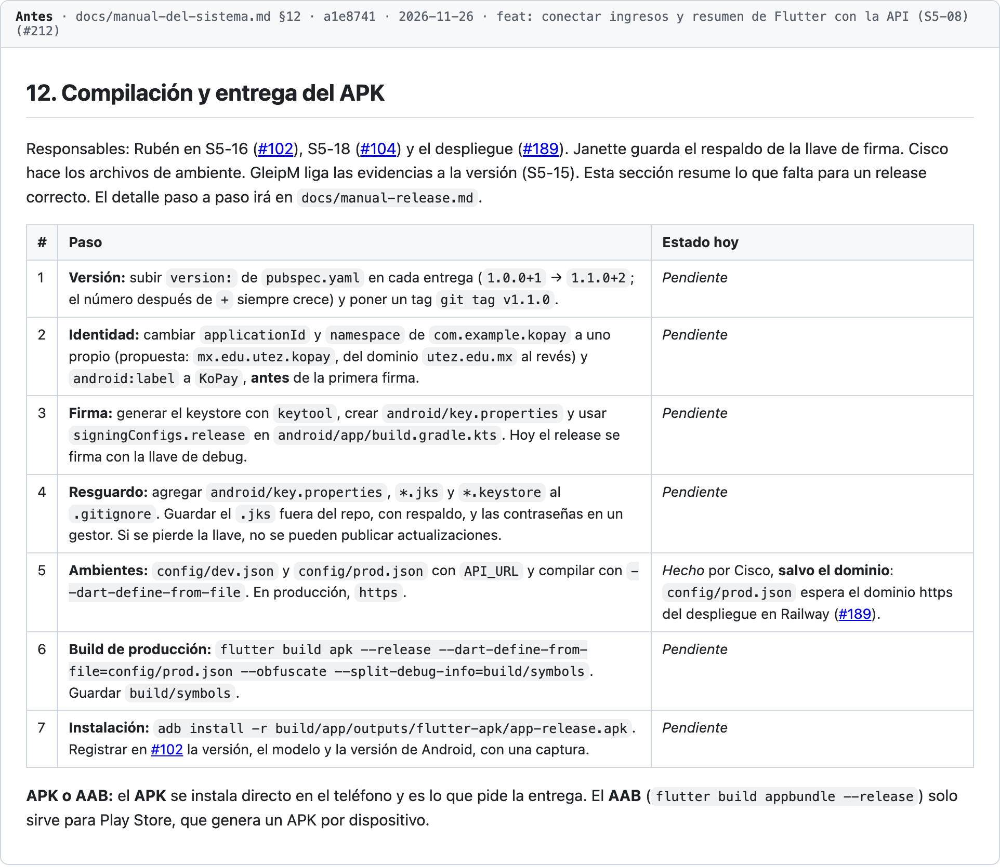
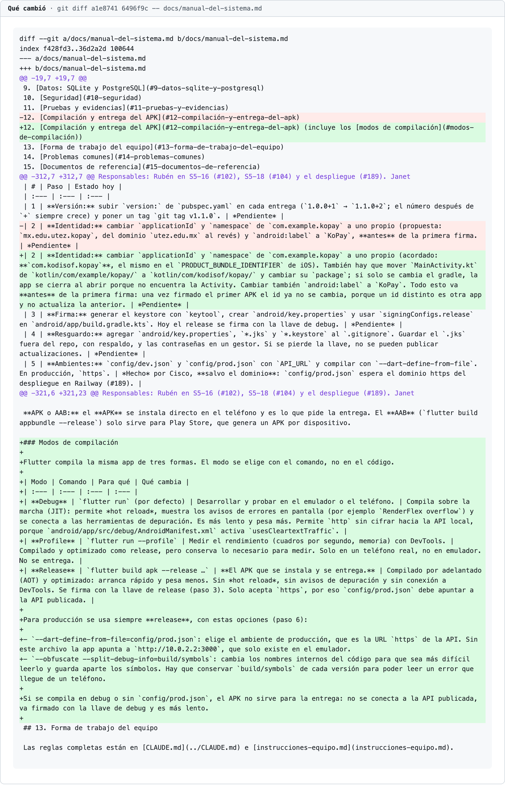

# Cambio del manual por "Firma y empaquetado"

**Para:** revisión en clase del entregable de la integradora.
**Cambio:** [#213](https://github.com/JanettheMillan/KoPay/pull/213), parte de S5-17 ([#103](https://github.com/JanettheMillan/KoPay/issues/103)). Hecho por Enrique (`EnriqueLanda2`) y revisado por Rubén (`RuAbogado`) el 26/11/2026.
**Archivo:** [`docs/manual-del-sistema.md`](manual-del-sistema.md), sección 12.

En clase se pidió que el manual del proyecto integrador cubriera, en "Firma y empaquetado", el **modo de compilación para producción**, además del versionamiento, el keystore y la firma, APK vs AAB, el resguardo de credenciales, la instalación del release y la configuración de ambientes. Al revisar el manual contra esa lista, todo estaba excepto la explicación de los modos de compilación. Además, el `applicationId` seguía con una propuesta que el equipo ya había cambiado.

## 1. Antes

La sección 12 tenía el comando de producción (paso 6), pero no explicaba qué es un modo de compilación ni por qué el APK de entrega debe ser *release*. El paso 2 proponía `mx.edu.utez.kopay`.

## 2. Después

- **Paso 2 · Identidad:** el id acordado es `com.kodisof.kopay`, el mismo en iOS. Indica que también hay que mover `MainActivity.kt` y cambiar su `package`, porque si no la app se cierra al abrir. También dice que, una vez firmado el primer APK, el id ya no se cambia.
- **Modos de compilación** (nuevo):
  - Tabla de **debug**, **profile** y **release**: comando, para qué sirve cada uno y qué cambia.
  - Las opciones del build de producción.
  - Por qué un APK en debug o sin `config/prod.json` no sirve para la entrega.

## 3. Qué cambió, línea por línea

En verde lo agregado y en rojo lo que se quitó (`git diff` del manual entre la versión anterior y #213).

## Cada punto del pizarrón en el manual

| Punto del pizarrón | Antes de #213 | Después de #213 | Dónde y qué dice el manual |
| :--- | :---: | :---: | :--- |
| **Versionamiento** | ✅ | ✅ | §12, paso 1: subir `version:` en `pubspec.yaml` (hoy `1.0.0+1`). El número después de `+` siempre crece y cada entrega lleva su `git tag`. |
| **Keystore y firma** | ✅ | ✅ | §12, paso 3: generar la llave con `keytool`, crear `android/key.properties` y usar `signingConfigs.release` en `android/app/build.gradle.kts`. |
| **APK vs AAB** | ✅ | ✅ | Final de §12: qué es cada uno y por qué se entrega el APK (el AAB es solo para Play Store). |
| **Resguardo de credenciales** | ✅ | ✅ | §12, paso 4: el keystore fuera del repo, en `.gitignore`, con respaldo, y las contraseñas en un gestor. §7: `backend/.env` nunca se sube y los secretos se comparten solo por privado. |
| **Instalación del release** | ✅ | ✅ | §12, paso 7: `adb install -r build/app/outputs/flutter-apk/app-release.apk` y qué registrar en #102 (versión, modelo, versión de Android y captura). |
| **Manual del proyecto integrador** | ✅ | ✅ | Es el propio [`manual-del-sistema.md`](manual-del-sistema.md), con 15 secciones. Es el entregable de la integradora, ligado a #103. |
| **Configuración de ambiente adicional al dev** | ✅ | ✅ | §7: variables de la API por ambiente; `config/dev.json`, `dev-local.json` y `prod.json` (ver [`config/README.md`](../config/README.md)); y las bases de development, test y production. |
| **Modo de compilación para producción** | 🟡 A medias | ✅ | Antes, §12 paso 6 solo tenía el comando (`--release`, `--obfuscate` y `--dart-define-from-file=config/prod.json`), sin explicar los modos. **Ahora** la sección "Modos de compilación" explica debug, profile y release, en qué cambia cada uno y por qué la entrega es release. |

Con #213, **todos los puntos del pizarrón quedan cubiertos en el manual**. Lo que sigue pendiente es la ejecución, que no es documentación: aplicar el `applicationId`, generar la llave, firmar e instalar el APK. Eso lo hace Rubén en S5-16 (#102), siguiendo estos pasos.

Las capturas se generaron del historial de git (`git show` de cada versión del manual, mostrado como en GitHub), así que muestran exactamente lo que había en cada versión.
