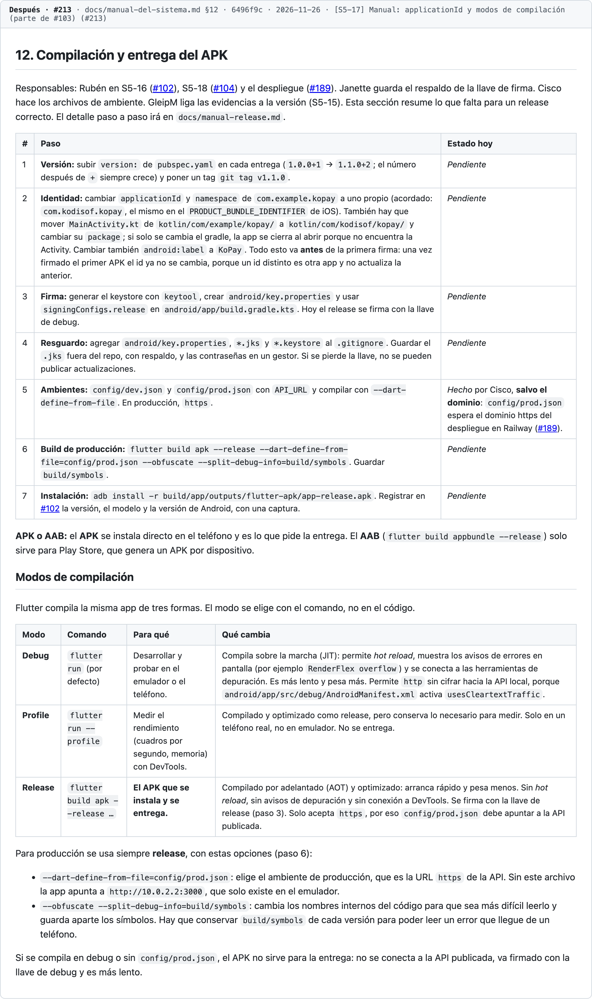

# Cambio del manual por "Firma y empaquetado"

**Para:** revisión en clase del entregable de la integradora.
**Cambio:** [#213](https://github.com/JanettheMillan/KoPay/pull/213), parte de S5-17 ([#103](https://github.com/JanettheMillan/KoPay/issues/103)). Hecho por Enrique (`EnriqueLanda2`) y revisado por Rubén (`RuAbogado`) el 26/11/2026.
**Archivo:** [`docs/manual-del-sistema.md`](manual-del-sistema.md), sección 12.

En clase se pidió que el manual del proyecto integrador cubriera, en "Firma y empaquetado", el **modo de compilación para producción**, además del versionamiento, el keystore y la firma, APK vs AAB, el resguardo de credenciales, la instalación del release y la configuración de ambientes. Al revisar el manual contra esa lista, todo estaba excepto la explicación de los modos de compilación. Además, el `applicationId` seguía con una propuesta que el equipo ya había cambiado.

## 1. Antes

La sección 12 tenía el comando de producción (paso 6), pero no explicaba qué es un modo de compilación ni por qué el APK de entrega debe ser *release*. El paso 2 proponía `mx.edu.utez.kopay`.

## 2. Después

- **Paso 2 · Identidad:** el id acordado es `com.kodisof.kopay`, el mismo en iOS. Indica que también hay que mover `MainActivity.kt` y cambiar su `package`, porque si no la app se cierra al abrir. También dice que, una vez firmado el primer APK, el id ya no se cambia.
- **Modos de compilación** (nuevo):
  - Tabla de **debug**, **profile** y **release**: comando, para qué sirve cada uno y qué cambia.
  - Las opciones del build de producción.
  - Por qué un APK en debug o sin `config/prod.json` no sirve para la entrega.

## 3. Qué cambió, línea por línea

En verde lo agregado y en rojo lo que se quitó (`git diff` del manual entre la versión anterior y #213).

## Dónde está cada punto del pizarrón en el manual

| Pizarrón | Sección del manual |
| :--- | :--- |
| Versionamiento | §12, paso 1 |
| Keystore y firma | §12, paso 3 |
| APK vs AAB | §12, "APK o AAB" |
| Resguardo de credenciales | §12, paso 4, y §7 |
| Instalación del release | §12, paso 7 |
| Configuración de ambiente adicional al dev | §7 y [`config/README.md`](../config/README.md) |
| Modo de compilación para producción | §12, paso 6, y "Modos de compilación" (**este cambio**) |
| Manual del proyecto integrador | Todo [`manual-del-sistema.md`](manual-del-sistema.md) |

Las capturas se generaron del historial de git (`git show` de cada versión del manual, mostrado como en GitHub), así que muestran exactamente lo que había en cada versión.
