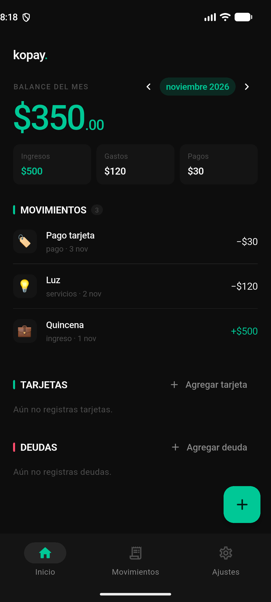

# Casos del resumen mensual (HU-09)

**Tarjeta:** #14 · Prueba unitaria e integración del resumen mensual.
**Historia:** HU-09 · Conocer el balance.
**Base:** `docs/historias-de-usuario.md` y `docs/plan-de-pruebas.md` (UT-34 a UT-46).

## 1. Qué calcula

`MonthSummary.of(movements, incomes, month)` (`lib/utils/month_summary.dart`) devuelve:

- **Ingresos:** suma de la tabla `incomes` más las entradas positivas de `movements`.
- **Gastos:** movimientos negativos que no son pagos.
- **Pagos:** movimientos con `type = payment` (tarjeta o deuda), separados de los gastos.
- **Gastos por categoría:** solo gastos ordinarios, de mayor a menor.
- **Saldo:** ingresos − gastos − pagos.

Inicio usa este cálculo y muestra **Pagos** como tercera tarjeta de la fila de totales cuando el mes tiene pagos, para que el saldo sea comprensible sin mover el resto de la pantalla.

## 2. Casos y resultado

| Caso | Historia | Preparación | Resultado esperado | Resultado |
| :--- | :--- | :--- | :--- | :--- |
| UT-34 | HU-09 | Listas vacías | Todo en cero | **Aprobado** |
| UT-35 | HU-02 | Ingreso de 500 en `incomes` | Ingresos 500 | **Aprobado** |
| UT-36 | HU-01 | Gasto de 50 | Gastos 50; saldo −50 | **Aprobado** |
| UT-37 | HU-03 | Movimiento positivo de 200 | Ingresos 200; no es gasto | **Aprobado** |
| UT-38 | HU-16 | Pago de 100 (`type = payment`) | Pagos 100; gastos 0 | **Aprobado** |
| UT-39 | HU-10 | Dos compras de Comida (−30 y −20) | Comida acumula 50 | **Aprobado** |
| UT-40 | HU-09 | Salud −20 y Comida −80 | Comida aparece primero | **Aprobado** |
| UT-41 | HU-08 | Ingreso y gasto del mes anterior | No alteran el mes actual | **Aprobado** |
| UT-42 | HU-09 | Ingresos 500, gastos 120, pagos 30 | Saldo 350 | **Aprobado** |
| UT-43 | HU-02 | Ingreso en `incomes`, sin copia en `movements` | Se suma una sola vez | **Aprobado** |
| UT-44 | HU-03 | Entrada positiva de 75 en Otros | Se suma una vez como ingreso | **Aprobado** (plan corregido) |
| UT-45 | HU-09 | Movimiento de monto cero | No altera nada | **Aprobado** |
| UT-46 | HU-08 | Último día del mes y primero del siguiente | Cada registro afecta solo a su mes | **Aprobado** |
| HOME-04 | HU-09 | Ingreso 500, gasto 120, pago 30 | Inicio muestra 500 / 120 / 30 y saldo 350 | **Aprobado** |

### Corrección del plan: UT-44

El plan anterior esperaba que un «movimiento positivo cuyo tipo no es income» no se sumara. El modelo real no tiene un tipo `income`; la entrada positiva es un `Movement` regular con importe positivo. **HU-03** exige que se incluya una sola vez en el resumen. Se actualizó UT-44 en `docs/plan-de-pruebas.md` con esa regla y la prueba la comprueba.

## 3. Ejecución

| Campo | Valor |
| :--- | :--- |
| Fecha | 2026-11-26 |
| Responsable | `Leonardo-20233tn223` |
| Versión o commit | `test/s2-hu-09-resumen-mensual` sobre `develop` en `6212619` |
| Entorno | Flutter 3.47.5 (stable), Windows 11, `flutter test` sin dispositivo |
| Archivos | `test/month_summary_test.dart`, `test/home_screen_test.dart` |
| Comando de los casos | `flutter test --no-pub test/month_summary_test.dart test/home_screen_test.dart -r expanded` |
| Salida | `00:02 +17: All tests passed!` |
| Comando de la suite | `flutter test --no-pub` (con `develop` en `60aa4f9` integrado) |
| Salida de la suite | `00:25 +363 ~3: All tests passed!` (363 aprobadas, 3 omitidas, 0 fallidas) |
| Análisis | `flutter analyze --no-pub` → `No issues found!` |

### Verificación en Android

| Campo | Valor |
| :--- | :--- |
| Dispositivo | Emulador Pixel 7 (`emulator-5554`), Android 16, 1080 × 2400 |
| Build | APK debug (`flutter build apk --debug --no-pub`) |
| Datos | Ingreso "Quincena" de 500, gasto "Luz" de 120 y pago "Pago tarjeta" de 30, todos de noviembre de 2026 |
| Resultado | Inicio muestra Ingresos `$500`, Gastos `$120`, Pagos `$30` y saldo `$350.00`. Las tres tarjetas caben en una fila y el botón + no tapa "Agregar deuda". |
| Captura |  |

## 4. Archivos de la tarjeta

- `lib/utils/month_summary.dart` (cálculo puro).
- `lib/screens/home_screen.dart` (Inicio usa el resumen y muestra Pagos en la fila de totales).
- `lib/utils/app_strings.dart` (etiqueta «Pagos» / «Payments»).
- `test/month_summary_test.dart` (UT-34 a UT-46).
- `test/home_screen_test.dart` (HOME-04, integración en Inicio).
- `docs/plan-de-pruebas.md` (UT-44 corregido).
