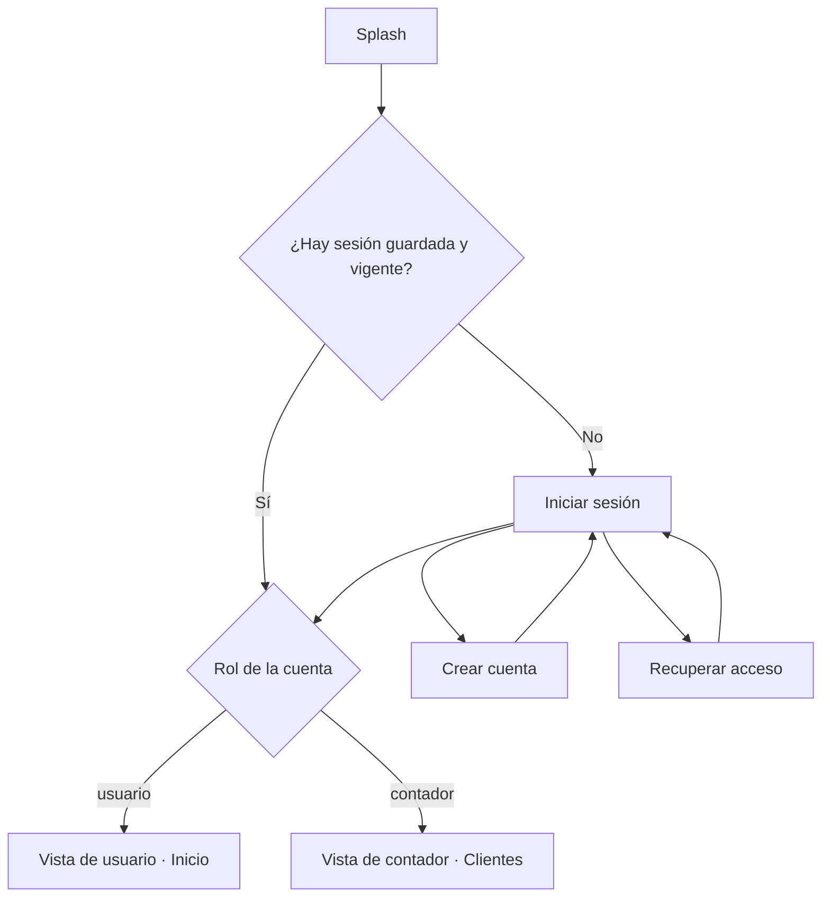
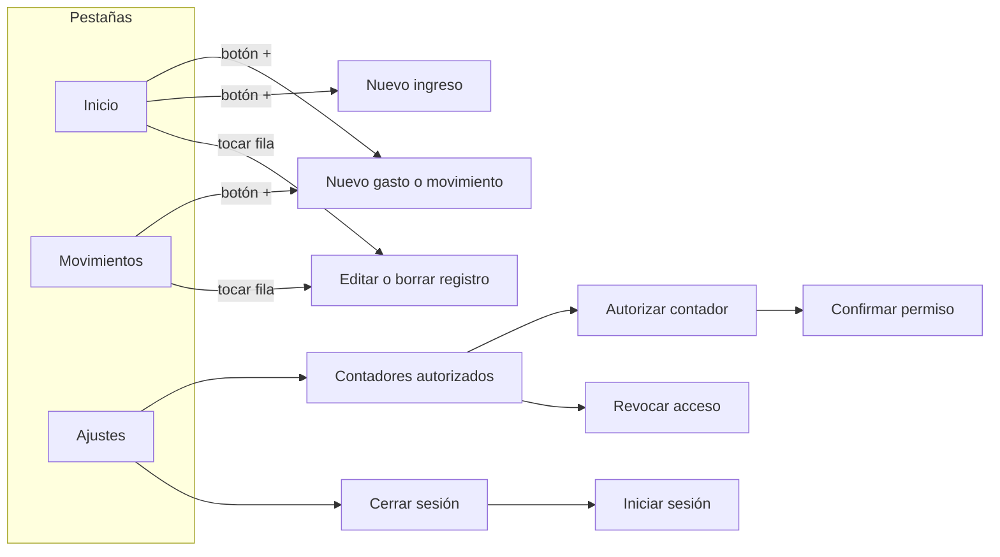
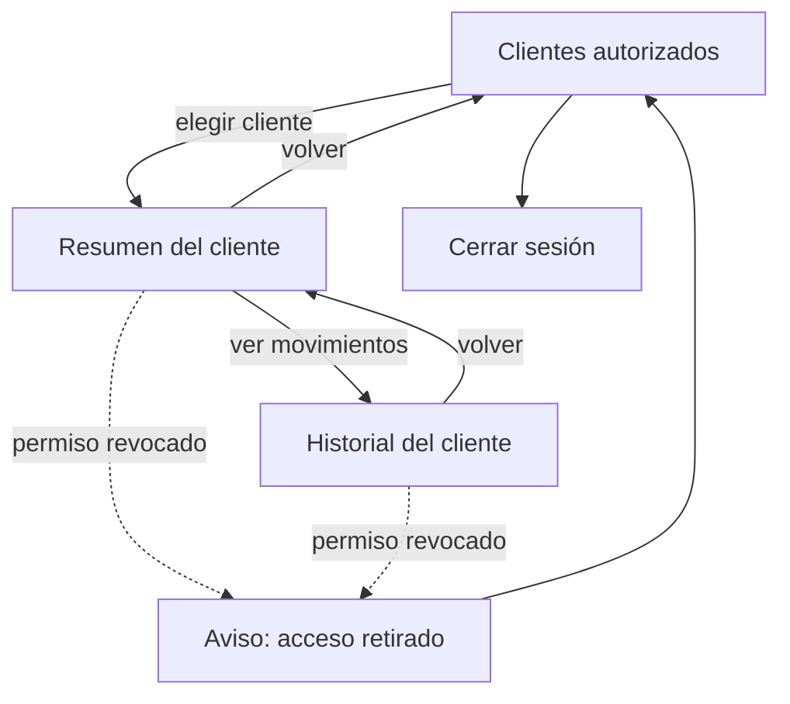

# Navegación de usuario y contador

**Tarjeta:** S1-19 · [#32](https://github.com/JanettheMillan/KoPay/issues/32). **Historias:** HU-30 a HU-34 (cuenta) y HU-37 a HU-42 (contador).
**Base:** [arquitectura.md](arquitectura.md), secciones 2 y 6.

Este documento define qué pantallas tiene cada vista, cómo se llega a ellas y qué puede hacer cada rol. Es el diseño para los Sprints 3 a 5. En el Sprint 1 solo existen Inicio, Movimientos, Ajustes y los formularios de gasto e ingreso, sin cuenta ni contador.

## 1. Roles

| Rol | Qué puede hacer | Qué no puede hacer |
| :--- | :--- | :--- |
| Usuario | Registrar, editar y borrar sus movimientos, ingresos, tarjetas y deudas. Autorizar y revocar contadores. | Ver datos de otras cuentas. |
| Contador | Ver la lista de personas que lo autorizaron. Consultar el resumen y el historial de una de ellas, por periodo. | Crear, editar o borrar registros de otra persona (HU-42). Ver a quien no lo autorizó o lo revocó. |

El rol viene de la cuenta con la que se inicia sesión (HU-37). La app abre una vista u otra según ese rol. **La API vuelve a comprobar el rol y el permiso en cada consulta**: ocultar un botón en Flutter no basta.

## 2. Entrada a la app

| Pantalla | Archivo previsto | Historia | Notas |
| :--- | :--- | :--- | :--- |
| Splash | `splash_screen.dart` | HU-31 | Lee la sesión guardada y decide a dónde ir. |
| Iniciar sesión | `login_screen.dart` | HU-31, HU-37 | Correo y contraseña. Enlaces a crear cuenta y recuperar acceso. |
| Crear cuenta | `register_screen.dart` | HU-30 | Las cuentas nuevas son de usuario. El rol de contador no se elige desde la app. |
| Recuperar acceso | `recover_screen.dart` | HU-32 | Pide el correo y confirma el envío sin revelar si la cuenta existe. |

## 3. Vista de usuario

Navegación inferior con tres pestañas, la misma que ya existe desde S1-05.

| Pantalla | Archivo previsto | Historias | Contenido |
| :--- | :--- | :--- | :--- |
| Inicio | `home_screen.dart` | HU-08, HU-09 | Selector de mes, balance, ingresos, gastos y últimos movimientos. Tarjetas y próximos pagos cuando existan. |
| Movimientos | `movements_screen.dart` | HU-07 | Lista de gastos e ingresos del más reciente al más antiguo. |
| Nuevo gasto o movimiento | `add_movement_sheet.dart` | HU-01, HU-03, HU-04 | Hoja inferior: monto, tipo, descripción, categoría, fecha y nota. |
| Nuevo ingreso | `add_income_sheet.dart` | HU-02, HU-04 | Hoja inferior: nombre, monto, fecha y nota. |
| Editar o borrar | Las mismas hojas con datos cargados | HU-05, HU-06 | Borrar pide confirmación. |
| Ajustes | `settings_screen.dart` | HU-24 a HU-28, HU-33 | Moneda, idioma, categorías, respaldo, borrar datos, contadores y cerrar sesión. |
| Contadores autorizados | `accountants_screen.dart` | HU-38, HU-41 | Lista de contadores con permiso vigente y botón para revocar cada uno. |
| Autorizar contador | `authorize_accountant_sheet.dart` | HU-38 | Se busca al contador por correo. |
| Confirmar permiso | Diálogo | HU-38 | Explica qué verá el contador (resumen e historial, solo lectura) y pide confirmar. Sin confirmación no se crea el permiso. |
| Revocar acceso | Diálogo | HU-41 | Confirma la revocación. Desde ese momento la API rechaza nuevas consultas de ese contador. |

### Consentimiento

1. En Ajustes → Contadores autorizados, el usuario toca **Autorizar contador**.
2. Escribe el correo del contador. Si no existe una cuenta de contador con ese correo, se muestra un error y no se crea nada.
3. Un diálogo resume el permiso: **quién** lo recibe, **qué** puede ver (resumen e historial), que es de **solo lectura** y que se puede **revocar** en cualquier momento.
4. Solo al tocar **Confirmar** se registra el permiso en el servidor. **Cancelar** no guarda nada.
5. El contador aparece en la lista con la fecha de autorización y el botón **Revocar**.

## 4. Vista de contador

La vista de contador no tiene navegación inferior ni botones para crear, editar o borrar.

| Pantalla | Archivo previsto | Historias | Contenido |
| :--- | :--- | :--- | :--- |
| Clientes autorizados | `accountant_clients_screen.dart` | HU-37, HU-39 | Lista con nombre, correo y fecha de autorización. Solo personas con permiso vigente. Si no hay ninguna, mensaje "Aún no tienes clientes autorizados". Botón de cerrar sesión. |
| Resumen del cliente | `accountant_summary_screen.dart` | HU-40 | Nombre del cliente arriba, selector de mes, balance, ingresos, gastos y pagos de tarjeta del periodo. Botón "Ver movimientos". |
| Historial del cliente | `accountant_history_screen.dart` | HU-40, HU-42 | Gastos e ingresos del periodo elegido, del más reciente al más antiguo. Las filas no se pueden tocar para editar. |
| Aviso de acceso retirado | Diálogo | HU-41 | Aparece si la API responde que el permiso ya no está vigente. Regresa a la lista de clientes, que se recarga. |

### Reglas de la vista de contador

- El mes elegido en el resumen se conserva al abrir el historial.
- Cada pantalla consulta a la API con el identificador del cliente y el periodo. La API comprueba el permiso en cada consulta, así que cambiar el identificador no da acceso a otra persona (HU-34, HU-40).
- No hay botón **+**, deslizar para borrar ni hojas de edición (HU-42). La API también rechaza escrituras de una cuenta de contador.

## 5. Matriz de pantallas por rol

| Pantalla | Usuario | Contador |
| :--- | :---: | :---: |
| Splash, iniciar sesión, recuperar acceso | Sí | Sí |
| Crear cuenta | Sí | No |
| Inicio, Movimientos, Ajustes | Sí | No |
| Formularios de gasto e ingreso | Sí | No |
| Contadores autorizados, autorizar y revocar | Sí | No |
| Clientes autorizados | No | Sí |
| Resumen e historial de un cliente | No (solo los propios en Inicio y Movimientos) | Sí, solo lectura |

## 6. Cómo se comprueba

| Recorrido | Historia | Resultado esperado |
| :--- | :--- | :--- |
| Una cuenta de usuario inicia sesión | HU-31, HU-37 | Abre Inicio y no ve pantallas de contador. |
| Una cuenta de contador inicia sesión | HU-37 | Abre Clientes autorizados y no ve la navegación de usuario. |
| El usuario autoriza y luego cancela | HU-38 | No se crea el permiso y el contador no ve al usuario. |
| El usuario autoriza y confirma | HU-38, HU-39 | El contador ve al usuario en su lista. |
| El contador abre el resumen y el historial de un mes | HU-40 | Solo aparecen datos de ese cliente y de ese mes. |
| El usuario revoca mientras el contador está en el historial | HU-41 | La siguiente consulta muestra "acceso retirado" y el cliente desaparece de la lista. |
| El contador intenta editar | HU-42 | No hay controles de edición y la API rechaza la escritura. |

Estos casos se ejecutarán cuando existan las pantallas y la API (Sprints 4 y 5). Los resultados se registrarán en el [plan de pruebas](plan-de-pruebas.md).
