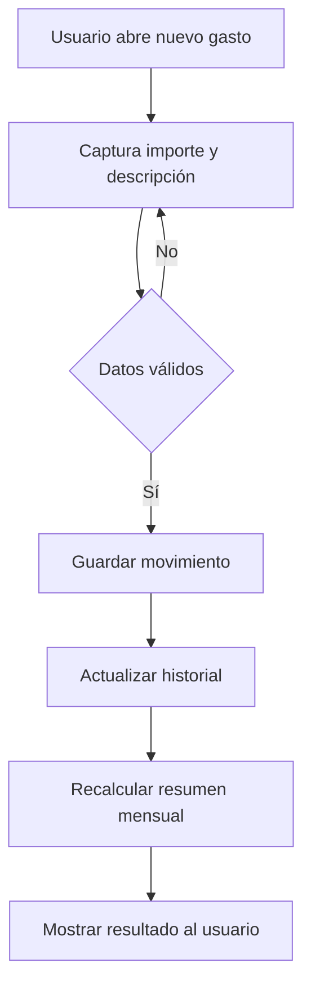

# Plan de desarrollo y entrega de KoPay

**Versión:** 4.0 · 8 de octubre de 2026  
**Periodo planificado:** 8 de octubre al 15 de diciembre de 2026  
**Repositorio de entrega indicado:** [JanettheMillan/KoPay](https://github.com/JanettheMillan/KoPay)  
**Tablero indicado:** [KoPay Project 3](https://github.com/users/JanettheMillan/projects/3)  
**Estado:** planificación; el avance se acredita con actividades y evidencias reales.

## 1. Idea y propósito

KoPay es una aplicación móvil para registrar ingresos, gastos, tarjetas, deudas y pagos próximos. La vista de usuario reúne movimientos y un resumen mensual para facilitar el control cotidiano del dinero. La vista de contador permite que una cuenta con ese rol consulte, con permiso explícito, el resumen y los movimientos de una persona. El usuario puede revocar el permiso. El contador no modifica registros financieros ajenos.

## 2. Forma de trabajo

El desarrollo se planifica desde la estructura inicial del proyecto Flutter en el repositorio de entrega. Los sprints ordenan la implementación de la interfaz, la persistencia local, el backend Node.js con PostgreSQL, la autenticación, las vistas de usuario y contador, el servicio externo y el APK. Cada Issue especifica un resultado verificable; su cierre requiere cambios, revisión y evidencia correspondientes. El calendario expresa trabajo previsto, no resultados ya obtenidos.

## 3. Alcance de la entrega del 15 de diciembre

| Módulo | Funciones objetivo | Sprints principales |
| :--- | :--- | :--- |
| Base móvil | Proyecto Flutter, tema, navegación, estado y persistencia local. | 1 |
| Finanzas personales | Gastos, movimientos positivos, ingresos, historial y resumen mensual. | 1 y 5 |
| Tarjetas y deudas | Alta, consulta, edición, pagos, saldos y próximos vencimientos. | 2 y 5 |
| Ajustes y datos | Categorías, moneda, idioma, exportación XLSX e importación CSV compatible. | 2 |
| Cuentas y sesión | Registro, inicio, recuperación de acceso, cierre y protección de rutas. | 3 y 4 |
| Backend y datos remotos | API Node.js, configuración por ambientes y base administrada para datos por cuenta. | 3 a 5 |
| Vista de usuario y contador | Roles, autorización, revocación, clientes autorizados, resumen e historial de solo lectura. | Definición en 1; desarrollo en 3 a 5 |
| Servicio externo | Integración de un servicio de terceros útil para la app, con fallos controlados. | 5 |
| Calidad y entrega | Casos unitarios, de interfaz e integración, evidencia de ejecución, APK y demostración. | Todos los sprints |

La sincronización entre dispositivos queda supeditada a la persistencia remota por cuenta y se verificará con cuentas de prueba. La recuperación de acceso necesita un mecanismo concreto acordado antes de cerrar la HU-32. El respaldo XLSX y la importación CSV son operaciones distintas: el XLSX exportado no se importa directamente con la opción CSV.

## 4. Historias, flujo y pruebas

Las [42 historias de usuario](historias-de-usuario.md) definen comportamiento y criterios verificables. El [plan de pruebas](plan-de-pruebas.md) contiene 85 casos propuestos: 79 unitarios, 3 de interfaz y 3 de integración. Las seis pruebas de interfaz e integración son una muestra de flujos prioritarios; no sustituyen la comprobación de los criterios de aceptación de las demás historias y entregables. Ningún caso se declara aprobado antes de registrar su ejecución.

El flujo del contador se documenta en [arquitectura.md](arquitectura.md): autenticación, consentimiento, comprobación de permiso en la API, consulta del cliente autorizado y revocación.

## 5. Organización y calendario

Se usa **Scrumban**: backlog priorizado, tablero visible, revisiones breves y máximo una tarea activa por desarrollador. Los cinco sprints propuestos duran de una a dos semanas. El [cronograma](cronograma-y-trazabilidad.md) resume los objetivos por persona; el [backlog detallado](backlog-desarrollo-desde-cero.md) contiene las 97 actividades con dependencia, responsable propuesto, historia y criterio de cierre. Su estado real se registrará en el Project.

| Sprint | Fechas | Resultado previsto |
| :--- | :--- | :--- |
| 1 | 8–23 oct. | Base Flutter, movimientos, ingresos y resumen; alcance de ambas vistas definido. |
| 2 | 24 oct.–6 nov. | Tarjetas, deudas, pagos, ajustes y respaldos. |
| 3 | 7–20 nov. | Node.js, esquema remoto, usuarios, roles y autenticación inicial. |
| 4 | 21 nov.–4 dic. | Sesiones, RBAC, autorización y estructura funcional de la vista de contador. |
| 5 | 5–15 dic. | API financiera, panel de contador con datos autorizados, servicio externo, pruebas y APK. |

Los responsables propuestos son Rubén, Enrique, Francisco, Janetthe, Maximiliano y Luis; sus tareas concretas están en el backlog. La cuenta de cada persona se confirma en el Project antes de asignar. Cada tarjeta de código tendrá rama, cambios reales, Pull Request y revisión; cada tarjeta de prueba tendrá fecha, versión, dispositivo, resultado observado y evidencia. Una tarea está lista si tiene objetivo, criterio y dependencias; termina cuando su resultado se verifica y se vincula al trabajo real.

## 6. Entregables y evidencias

| Entregable | Evidencia prevista |
| :--- | :--- |
| Alcance, arquitectura y patrón | Este plan, [arquitectura](arquitectura.md) y diagramas editables. |
| Historias y pruebas | [Historias](historias-de-usuario.md), [plan de pruebas](plan-de-pruebas.md) y resultados fechados. |
| Seguimiento | Tarjetas del Project, capturas al cierre de sprint y [guía de evidencias](guia-de-evidencias.md). |
| Aplicación | Código integrado, PR revisados, demostración de usuario y contador, y APK instalable. |
| Técnica integradora | Configuración por ambientes, base administrada y servicio de terceros documentados y comprobados. |

## 7. Fuera de alcance y riesgos

Por ahora no se planifican conexión automática con bancos, edición de finanzas ajenas por el contador ni informes contables descargables. Si se requieren, se agregan historias, pruebas y tarjetas antes de prometerlos. El mayor riesgo del calendario es concentrar API financiera, contador, integración y APK en el Sprint 5. El equipo debe revisar capacidad en cada cierre y adelantar trabajo dependiente cuando sea posible, manteniendo el 15 de diciembre como fecha objetivo.

## 8. Estado de este documento

Este plan es una propuesta de trabajo completa. Las 97 actividades tienen [Issues vinculados en el backlog](backlog-desarrollo-desde-cero.md) y aparecen en el Project indicado. Crear y asignar una tarjeta no significa que su trabajo o sus pruebas ya estén terminados. Los avances, commits y resultados se registrarán con evidencia real.
